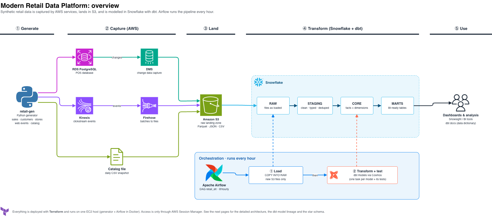
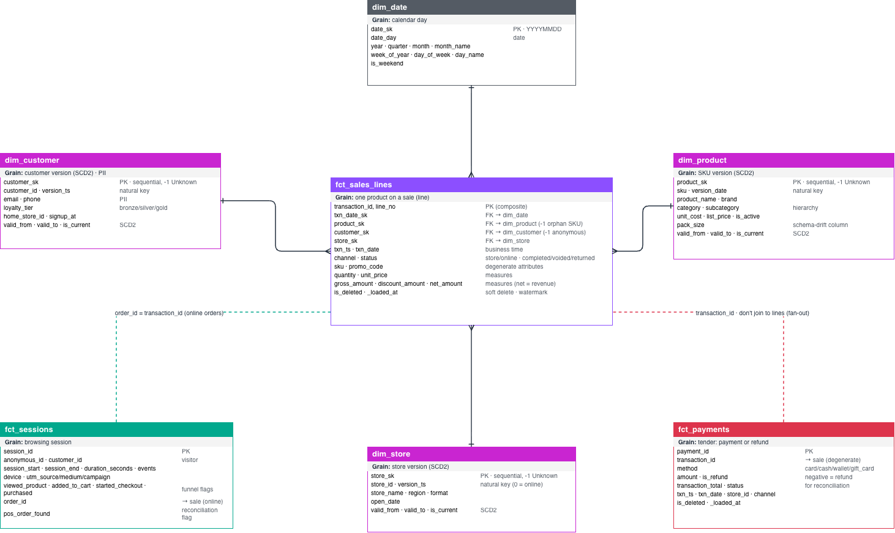

# Modern Retail Data Platform (AWS + Snowflake + dbt + Airflow)

An end-to-end analytics engineering project. A synthetic retailer (physical stores and an online
shop) produces data in real AWS source systems. The data lands in S3, is loaded into Snowflake
hourly by Airflow, and is modelled with dbt into a documented, tested star schema.



*Overview of the platform. The detailed architecture, the dbt model lineage and the star schema are in [`docs/architecture.drawio`](docs/architecture.drawio) (open it at [app.diagrams.net](https://app.diagrams.net)).*

**Contents**
1. [Architecture](#1-architecture)
2. [Data sources](#2-data-sources)
3. [Data model (dbt)](#3-data-model-dbt)
4. [Repository layout](#4-repository-layout)
5. [Prerequisites](#5-prerequisites)
6. [Setup, step by step](#6-setup-step-by-step)
7. [Day-to-day operations](#7-day-to-day-operations)
8. [Run dbt locally](#8-run-dbt-locally)
9. [Cost: pause, resume, destroy](#9-cost-pause-resume-destroy)
10. [Troubleshooting](#10-troubleshooting)
11. [Reference: make targets and design decisions](#11-reference)

---

## 1. Architecture

```
                    ┌────────────────────── EC2 platform host (t3.medium) ──────────────────────┐
                    │  retail-gen (Python, uv)              Airflow 3 (Docker: Cosmos + dbt)     │
                    └─────┬───────────────┬──────────────┬──────────────────────┬──────────────┘
                          │ inserts,      │ events       │ daily CSV            │ hourly: COPY INTO, then dbt
                          │ updates,      │              │                      │
                          ▼ deletes       ▼              ▼                      │
              RDS PostgreSQL (pos)   Kinesis stream   S3 catalog/products/      │
                          │               │                                     │
          DMS task (CDC)            Firehose (JSONL.gz)                         │
                          ▼               ▼                                     ▼
   S3  s3://modern-retail-data-platform-20261007/                         Snowflake RETAIL
         pos/pos/<table>/YYYY/MM/DD/*.parquet                              RAW      (COPY INTO)
         clickstream/events/dt=…/hh=…/*.gz        ── storage integration ─▶ STAGING  (views)
         catalog/products/dt=…/*.csv                                       CORE     (dims + facts)
         terraform/  (Terraform state, reserved)                           MARTS    (BI tables)
```

**Full diagram:** [`docs/architecture.drawio`](docs/architecture.drawio), with official AWS icons and four pages: (1) a **simple overview** (generate → capture → land → transform → use), (2) the detailed architecture with the numbered data flow, (3) the ELT layers and dbt model lineage, (4) the CORE star schema with grain and keys. Open it at [app.diagrams.net](https://app.diagrams.net) (File → Open from → Device) or with the draw.io extension in VS Code / Cursor. To embed it, export a page as PNG or SVG.

- **Infrastructure:** Terraform ([`infra/terraform`](infra/terraform)), one flat root with one file per concern.
- **Orchestration:** one Airflow DAG, [`retail_elt`](airflow/dags/retail_elt.py), runs hourly. It loads RAW, then runs dbt through **Cosmos**, so every dbt model and its tests appear as separate Airflow tasks.
- **Access:** nothing is publicly reachable. The EC2 host, the Airflow UI, the dbt docs and RDS are all reached through **AWS SSM** (Session Manager).

## 2. Data sources

Full contract, with columns, change behaviour, shared keys and defects: [`docs/source-contracts.md`](docs/source-contracts.md).

| Source | System | Ingestion | Lands in S3 as |
|---|---|---|---|
| **POS / orders** (`stores`, `customers`, `transactions`, `transaction_lines`, `payments`) | RDS PostgreSQL 16 | DMS replication task, **CDC only** | Parquet with `Op` (I/U/D) and `_dms_commit_ts` |
| **Clickstream** (page views → purchase funnel) | Kinesis Data Streams | Firehose | JSON Lines, gzip, partitioned by arrival time |
| **Product catalog** (third-party supplier) | Daily file | Uploaded by the generator | CSV, full snapshot per day |

The generator ([`generators/`](generators), config in [`default.yaml`](generators/config/default.yaml)) seeds 30 days of history and then runs a live loop every 30 s. That loop produces sales, voids and returns (with refunds), hard deletes, loyalty sign-ups, tier changes, store openings and changes, clickstream sessions, and a daily catalog file. It also **plants defects** on purpose (duplicates, late events, nulls, invalid values, orphan SKUs, payment mismatches, schema drift), so the dbt tests have something real to catch.

## 3. Data model (dbt)

Project: [`dbt/retail`](dbt/retail). Every model and column is documented (grain, keys, refresh, usage), and the descriptions are also written to Snowflake as comments.

| Layer | Schema | Models | Notes |
|---|---|---|---|
| Sources | `RAW` | 7 tables | Loaded by `COPY INTO`. POS and clickstream rows land whole as `record` VARIANT. |
| Staging | `STAGING` | `stg_pos__*` (+ `stg_pos__*_cdc`), `stg_clickstream__events`, `stg_catalog__products` | Typed columns, duplicates removed. **Every POS table has two views:** `stg_pos__<table>_cdc` keeps every change (one row per CDC event), and `stg_pos__<table>` keeps the latest version per key. Both carry `cdc_operation` (`INSERT`/`UPDATE`/`DELETE`) and `_dms_commit_ts`. |
| Core | `CORE` | `dim_date`, `dim_store`, `dim_customer`, `dim_product`, `fct_sales_lines`, `fct_payments`, `fct_sessions` | Star schema. SCD2 dimensions; incremental facts. |
| Marts | `MARTS` | `mart_daily_sales`, `mart_web_funnel` | Aggregates for BI. |

| Model | Grain (one row per…) |
|---|---|
| `dim_store` / `dim_customer` / `dim_product` | store / customer / SKU **version** (SCD2) |
| `dim_date` | day |
| `fct_sales_lines` | product on a sale (transaction line) |
| `fct_payments` | tender: a payment, or a refund (negative amount) |
| `fct_sessions` | browsing session |
| `mart_daily_sales` | day × store × channel |
| `mart_web_funnel` | day |

**Dimensional model (CORE star schema):**



*`fct_sales_lines` (one row per product on a sale) joins each dimension through its surrogate key: the dimension is the "one" side, the fact the "many" side. Dashed lines are degenerate keys, not joins: `fct_sessions.order_id` = `transaction_id` for online orders, and `fct_payments` must not be joined to sales lines (fan-out). Editable source: page 4 of [`docs/architecture.drawio`](docs/architecture.drawio).*

**Modelling conventions:**
- **Surrogate keys (Kimball):** `*_sk` are meaningless sequential integers, assigned once per dimension version and never changed ([`macros/surrogate_key.sql`](dbt/retail/macros/surrogate_key.sql)). `-1` is the **Unknown** member, so fact keys are never null. `date_sk` is a `YYYYMMDD` integer.
- **SCD2:** `valid_from ≤ t < valid_to` (null = current). Facts carry the key of the version valid at the time of the sale.
- **CDC handling:** the latest `_dms_commit_ts` wins. Staging marks hard deletes with `cdc_operation = 'DELETE'`; the facts keep them as rows with `is_deleted = true`.
- **Incremental models** use `_loaded_at` (arrival time) as the watermark, so late data is picked up.
- **Tests:** keys and relationships are **errors**; planted source defects are **warnings**. Cosmos runs each model's tests right after the model (`buildable` indirect selection, so a test spanning two models runs with the downstream one).

## 4. Repository layout

| Path | Contents |
|---|---|
| [`infra/create_remote_state.sh`](infra/create_remote_state.sh) | One-time creation of the S3 bucket (Terraform state and landing data) |
| [`infra/terraform/`](infra/terraform) | AWS infrastructure: `network`, `iam`, `s3`, `rds`, `dms`, `streaming`, `ec2`, `glue`, `snowflake`, `budget` |
| [`scripts/setup_host.sh`](scripts/setup_host.sh) | EC2 first-boot setup: Docker, Compose, buildx, uv, repo clone, Airflow |
| [`scripts/init_db.sh`](scripts/init_db.sh) | Runs a SQL file against RDS (creates the POS schema) |
| [`scripts/dbt_docs.sh`](scripts/dbt_docs.sh) | Generates and serves dbt docs on the host |
| [`sql/pos/`](sql/pos) | POS schema (`01_schema.sql`) and a one-off refund backfill (`02_…`) |
| [`generators/`](generators) | `retail-gen`, the synthetic data generator (uv project) |
| [`airflow/`](airflow) | `Dockerfile` (Airflow + Cosmos + dbt), `docker-compose.yaml`, `dags/retail_elt.py` |
| [`snowflake/setup.sql`](snowflake/setup.sql) | One-time Snowflake setup (a Terraform template) |
| [`dbt/retail/`](dbt/retail) | dbt project: models, tests, macros, docs, `profiles.yml` |
| [`docs/source-contracts.md`](docs/source-contracts.md) | Source data contract and data dictionary |

## 5. Prerequisites

**On your laptop:**
- AWS CLI v2 with admin credentials for the target account (`us-east-1`)
- Terraform ≥ 1.10, `jq`, `make`
- Session Manager plugin: `brew install --cask session-manager-plugin`
- `uv`, only for [running dbt locally](#8-run-dbt-locally)

**Accounts:**
- A Snowflake account and a user with the **ACCOUNTADMIN** role (Snowsight access)
- This repository on GitHub, **public**, because the EC2 host clones it on boot (`repo_url`)

## 6. Setup, step by step

Laptop steps run from the repo root. Host steps run on the EC2 host as root (see [6.4](#64-bring-up-the-sources-on-the-ec2-host)).

### 6.1 One-time: create the bucket
The bucket holds the Terraform state (under `terraform/`, with S3 lock files) and all landing data. Terraform never creates or deletes it.
```bash
bash infra/create_remote_state.sh
```

### 6.2 Deploy the AWS infrastructure
```bash
cp infra/terraform/terraform.tfvars.example infra/terraform/terraform.tfvars   # review it
make tf-init tf-validate
make tf-plan
make tf-apply
```
This creates the VPC, RDS, the DMS replication instance and task (not started), Kinesis and Firehose, the EC2 host, IAM, secrets, Glue, the budget, and a key pair for Snowflake.

The EC2 host then sets itself up (about 5 minutes): it installs Docker, clones the repo to `/opt/retail` and starts Airflow. Its settings come from `/etc/retail/platform.env`, which Terraform writes. Only database credentials are kept in Secrets Manager.

### 6.3 Set up Snowflake
1. Copy the setup script. Terraform renders it with this stack's role ARN, bucket and public key:
   ```bash
   terraform -chdir=infra/terraform output -raw snowflake_setup_sql | pbcopy
   ```
2. In **Snowsight**, open a new SQL worksheet, paste, and click **Run All**. The script switches to ACCOUNTADMIN itself and is safe to re-run. It creates:
   - warehouse `RETAIL_WH` (XSMALL, auto-suspends after 60 s)
   - role `RETAIL_ROLE` and service user `RETAIL_SVC` (key-pair auth)
   - storage integration `S3_RAW_INT`
   - database `RETAIL` with schemas `RAW`, `STAGING`, `CORE` and `MARTS`, plus the stages, file formats and RAW tables
3. Copy three values into `infra/terraform/terraform.tfvars`:
   - from the last result (`DESC INTEGRATION S3_RAW_INT`): `STORAGE_AWS_IAM_USER_ARN` and `STORAGE_AWS_EXTERNAL_ID`
   - your account identifier, in the form `ORGNAME-ACCOUNTNAME`. It's shown in Snowsight under Account → View account details, or run `SELECT CURRENT_ORGANIZATION_NAME() || '-' || CURRENT_ACCOUNT_NAME();`.
   ```hcl
   snowflake_account      = "ORGNAME-ACCOUNTNAME"
   snowflake_iam_user_arn = "<STORAGE_AWS_IAM_USER_ARN>"
   snowflake_external_id  = "<STORAGE_AWS_EXTERNAL_ID>"
   ```
4. Apply again. This lets Snowflake assume the platform role to read S3, and completes the Airflow `snowflake_default` connection:
   ```bash
   make tf-plan
   make tf-apply
   ```

> Whenever Terraform re-creates the Snowflake key pair (for example after `make tf-destroy` and a redeploy), Snowflake must be given the new public key, or every Snowflake task fails with `JWT token is invalid`. See [Snowflake key after a rebuild](#snowflake-key-after-a-rebuild).

### 6.4 Bring up the sources (on the EC2 host)
1. **Open a shell on the host.** Use `make ssm`, or in the AWS console go to EC2 → `retail-data-platform-dev-platform` → Connect → Session Manager. Then switch to root:
   ```bash
   sudo -i
   ```
   ```bash
   tail -n 3 /var/log/platform-setup.log
   ```
   It should end with `[setup] done`. If it doesn't, re-run `/usr/local/sbin/setup_host.sh` (it's idempotent) and read the error.
2. **Create the POS schema:**
   ```bash
   bash /opt/retail/scripts/init_db.sh
   ```
3. **Start the DMS task before seeding.** The task runs CDC only: it captures changes made after it starts and does no full load. Starting takes a minute or two:
   ```bash
   aws dms start-replication-task --replication-task-arn "$DMS_TASK_ARN" --start-replication-task-type start-replication
   ```
   Re-run this until it prints `running` (or use `make dms-status` from your laptop):
   ```bash
   aws dms describe-replication-tasks --filters Name=replication-task-arn,Values="$DMS_TASK_ARN" --query 'ReplicationTasks[0].Status' --output text
   ```
4. **Seed 30 days of history.** This loads stores, customers, about 300k sales with their lines and payments, and 30 catalog files. DMS streams every row to S3:
   ```bash
   cd /opt/retail/generators && uv run retail-gen seed
   ```
5. **Start the live generator** in the background. It keeps running after you close the session:
   ```bash
   systemd-run --unit retail-gen --working-directory /opt/retail/generators --setenv HOME=/root /usr/local/bin/uv run --frozen retail-gen run
   ```
   ```bash
   journalctl -u retail-gen -f
   ```
   Every 30 s it logs `cycle: new_stores=… new_customers=… sales=… voids=… refunds=… events=…`. Ctrl+C stops following the log, not the generator.
6. **Check that data is landing in S3** (Firehose flushes about every 60 s):
   ```bash
   for p in pos/pos clickstream/events catalog/products; do aws s3 ls "s3://$RAW_BUCKET/$p/" --recursive | tail -2; done
   ```

### 6.5 Run the pipeline in Airflow
1. On your laptop, open the UI tunnel, then go to http://localhost:8080. There's no login, because the UI is only reachable through the tunnel:
   ```bash
   make airflow-ui
   ```
2. Unpause **`retail_elt`** and trigger it. The `load_raw.copy_*` tasks run first, then the `dbt` task group (source freshness, then each model's run and test tasks).
3. Check in Snowsight:
   ```sql
   USE ROLE RETAIL_ROLE; USE WAREHOUSE RETAIL_WH;
   SELECT COUNT(*) FROM RETAIL.RAW.POS_TRANSACTIONS;
   SELECT * FROM RETAIL.MARTS.MART_DAILY_SALES ORDER BY txn_date DESC LIMIT 20;
   SELECT * FROM RETAIL.MARTS.MART_WEB_FUNNEL ORDER BY session_date DESC;
   ```
   Planted defects show up as **warnings** in the dbt test tasks; they don't fail the run. A second run loads 0 new files for anything already loaded, and incremental facts keep the same row counts.

## 7. Day-to-day operations

### Generator
Run these on the host, as root:

| Task | Command |
|---|---|
| Status / logs | `systemctl status retail-gen` · `journalctl -u retail-gen -f` |
| Stop | `systemctl stop retail-gen` |
| Restart after `git pull` | `systemctl stop retail-gen; systemctl reset-failed retail-gen`, then the `systemd-run` command from 6.4 |
| One test cycle | `cd /opt/retail/generators && uv run retail-gen run --once` |
| Change volumes and defect rates | Edit [`generators/config/default.yaml`](generators/config/default.yaml), push, pull on the host, restart |

The generator unit isn't persistent: start it again after the host reboots. **Re-seeding** (`seed --force`) truncates the POS tables, which DMS doesn't replicate. Only do it together with clearing the S3 landing prefixes and emptying the RAW tables.

### DMS (from your laptop)
`make dms-status` shows the state and per-table changes. `make dms-stop` pauses replication; `make dms-resume` continues without losing changes.

### Airflow
Run these on the host, in `/opt/retail/airflow`:

| Task | Command |
|---|---|
| Containers / logs | `docker compose ps` · `docker compose logs -f airflow-scheduler` |
| CLI | `docker compose exec airflow-scheduler airflow dags list` |
| Deploy DAG or dbt changes | `git -C /opt/retail pull`. The DAG and dbt folders are mounted into the containers, so they're picked up automatically. |
| Rebuild the image or apply setup changes | `/usr/local/sbin/setup_host.sh` (runs `docker compose up -d --build`) |

### Edit source data with DBeaver
RDS is private; reach it through an SSM tunnel.
```bash
make rds-tunnel
```
```bash
make rds-credentials
```
In DBeaver, create a **PostgreSQL** connection to `localhost:15432`, database `retail`, user `retail_admin`, with the password printed above. On the Driver properties tab, set `sslmode` = `require`. Edits are real source changes: DMS replicates them, and they reach Snowflake on the next `retail_elt` run. To hard-delete a sale, delete its `payments` and `transaction_lines` rows before the `transactions` row.

### Snowflake key after a rebuild

**Why:** Airflow and local dbt log in to Snowflake as `RETAIL_SVC` with **key-pair authentication**. Terraform generates the key pair (`tls_private_key.snowflake` in [`snowflake.tf`](infra/terraform/snowflake.tf)):
- the **private key** goes into Secrets Manager (`<prefix>/airflow/connections/snowflake_default`), where Airflow reads it on every run;
- the **public key** must be registered on the Snowflake user (`RSA_PUBLIC_KEY`). Snowflake checks every login against it.

**When:** whenever Terraform re-creates the key, for example after `make tf-destroy` and a redeploy, or after a partial destroy. AWS then holds a new private key while Snowflake still has the old public key, and every Snowflake task fails with:
```
390144 (28000): Failed to connect to DB: <account>.snowflakecomputing.com:443. JWT token is invalid.
```
The account and the storage integration don't change, so the values in `terraform.tfvars` stay valid. Only the key needs updating.

**Fix:**
1. On your laptop, copy the statement that registers the current public key:
   ```bash
   terraform -chdir=infra/terraform output -raw snowflake_setup_sql | grep "RSA_PUBLIC_KEY" | pbcopy
   ```
   The clipboard now holds `ALTER USER RETAIL_SVC SET RSA_PUBLIC_KEY = 'MIIB…';`.
2. In a Snowsight worksheet, run it as ACCOUNTADMIN:
   ```sql
   USE ROLE ACCOUNTADMIN;
   -- paste the copied ALTER USER … line here
   ```
   Re-running the whole setup script (6.3 steps 1–2) does the same, because it's safe to re-run.
3. In Airflow, clear the failed tasks or trigger `retail_elt` again. Nothing needs restarting, because Airflow reads the key from Secrets Manager on every run.

**Check that the keys match** (optional). In Snowsight:
```sql
DESC USER RETAIL_SVC;   -- RSA_PUBLIC_KEY_FP = SHA256:<fingerprint>
```
On your laptop, compute the fingerprint of the key Terraform holds; it must equal the part after `SHA256:`:
```bash
terraform -chdir=infra/terraform output -raw snowflake_setup_sql | grep -o "RSA_PUBLIC_KEY = '[^']*'" | cut -d"'" -f2 | base64 -d | openssl dgst -sha256 -binary | openssl enc -base64
```

### dbt docs (on the host)
On the host, as root (leave it running):
```bash
bash /opt/retail/scripts/dbt_docs.sh
```
On your laptop, open the tunnel, then go to http://localhost:8081:
```bash
make dbt-docs
```

## 8. Run dbt locally

Run dbt from your laptop against Snowflake, with the same project and the same `RETAIL_SVC` key-pair login as Airflow. [`dbt/retail/profiles.yml`](dbt/retail/profiles.yml) reads the account and key from environment variables, so no secret is ever written to a file.

> **There's one environment:** local runs build the same `STAGING`, `CORE` and `MARTS` tables as the DAG. Use `--select`, avoid running at the same time as the DAG, and never `--full-refresh` a dimension on its own (its surrogate keys would be re-assigned under the facts).

1. **Install dbt** (once), with the same versions as the Airflow image:
   ```bash
   uv tool install dbt-core --with dbt-snowflake==1.12.1
   ```
2. **Authenticate** (in each new terminal). This loads the account and key from Secrets Manager:
   ```bash
   SF_CONN=$(aws secretsmanager get-secret-value --secret-id retail-data-platform-dev/airflow/connections/snowflake_default --query SecretString --output text)
   export SNOWFLAKE_ACCOUNT=$(jq -r '.extra | fromjson | .account' <<<"$SF_CONN")
   export SNOWFLAKE_PRIVATE_KEY=$(jq -r '.extra | fromjson | .private_key_content' <<<"$SF_CONN")
   unset SF_CONN
   ```
3. **Connect:**
   ```bash
   cd dbt/retail && export DBT_PROFILES_DIR=$PWD
   dbt deps
   dbt debug
   ```
   It should end with `All checks passed!`.

| Command | What it does |
|---|---|
| `dbt parse` | Validates the project without touching Snowflake |
| `dbt ls --select +fct_sales_lines` | Lists a model and everything upstream of it |
| `dbt compile --select fct_sales_lines` | Renders the SQL into `target/compiled/` |
| `dbt show --select stg_pos__transactions --limit 10` | Previews rows |
| `dbt run --select stg_pos__transactions` / `--select staging` | Builds one model or a whole folder |
| `dbt test --select fct_sales_lines --indirect-selection buildable` | Runs a model's tests the same way the DAG does |
| `dbt build --select +mart_daily_sales` | Runs and tests a mart and all its parents |
| `dbt source freshness` | Shows how recently each RAW table was loaded |
| `dbt docs generate && dbt docs serve` | Opens the docs at http://localhost:8080 |

## 9. Cost: pause, resume, destroy

| Resource | Running cost (approx.) | Control |
|---|---|---|
| EC2 `t3.medium` | ~$30/month | `make ec2-stop` / `make ec2-start` |
| RDS `db.t4g.small` | ~$25/month | `aws rds stop-db-instance --db-instance-identifier retail-data-platform-dev-pos`. AWS restarts it after 7 days. |
| DMS replication instance `dms.t3.small` | ~$26/month while it exists, even when the task is stopped | `make dms-stop` / `make dms-resume` pause the task only; `enable_dms = false` removes the instance |
| Kinesis (on-demand) | ~$0.04/hour while the stream exists | Destroy only |
| Snowflake `RETAIL_WH` | Only while queries run | Auto-suspends after 60 s; pause `retail_elt` when idle |

**Pause for a few days:**
1. On the host: `systemctl stop retail-gen`.
2. In Airflow: pause `retail_elt`.
3. On your laptop: `make dms-stop`, `make ec2-stop`, then stop RDS.

**Resume:** start RDS, run `make ec2-start` and `make dms-resume`, start the generator again (6.4 step 5), and unpause the DAG.

**Destroy everything:**
```bash
make tf-destroy
```
This removes everything Terraform created, including RDS with no final snapshot. The bucket (landing data and state) and Snowflake survive. After a redeploy:
- Register the new Snowflake key ([Snowflake key after a rebuild](#snowflake-key-after-a-rebuild)). The new stack has a new key pair; the integration values in `terraform.tfvars` stay valid.
- Bring the sources up again (6.4).
- For a clean slate, first empty the landing prefixes, then drop `RETAIL` in Snowflake:
  ```bash
  for p in pos clickstream catalog; do aws s3 rm "s3://modern-retail-data-platform-20261007/$p/" --recursive; done
  ```

A monthly AWS budget alert (`alert_email`, `monthly_budget_usd`) emails at 80 % actual and 100 % forecast.

## 10. Troubleshooting

| Symptom | Cause and fix |
|---|---|
| `SessionManagerPlugin is not found` | Install the plugin: `brew install --cask session-manager-plugin` |
| `Connection to destination port failed` (tunnel) | Nothing is listening on the host yet. Start the server first (for example `dbt_docs.sh`), or check `docker compose ps`. |
| `cannot open '.git/FETCH_HEAD': Permission denied` | You're not root on the host. Run `sudo -i` first. |
| `/opt/retail: No such file or directory` | You ran a host command on your laptop. Open a Session Manager shell. |
| DAG doesn't appear in Airflow | The changes aren't pushed and pulled (`git push`, then `git -C /opt/retail pull`), or there's a DAG import error. Look at the banner in the UI, or run `docker compose logs airflow-dag-processor`. |
| `compose build requires buildx` | Re-run `/usr/local/sbin/setup_host.sh`, which installs buildx. |
| Snowflake `404 Not Found … login-request` | `snowflake_account` must be `ORGNAME-ACCOUNTNAME`, not a bare locator. Fix it in tfvars and apply. |
| `JWT token is invalid` | Snowflake has an old public key: the key pair was re-created by a rebuild. Register the new one; see [Snowflake key after a rebuild](#snowflake-key-after-a-rebuild). |
| `File format 'PARQUET_FMT' does not exist` | The stages were created by an old version of the script. Re-run the current setup script; it replaces the stages. |
| `Unit retail-gen.service was already loaded` | `systemctl stop retail-gen; systemctl reset-failed retail-gen`, then start it again. |
| `CLICKSTREAM_EVENTS` is empty | Clickstream is live-only. Start the generator (6.4 step 5). |
| `Error acquiring the state lock` | Another Terraform run holds it (often a `destroy` waiting for `yes` in another tab). Finish or cancel it; don't force-unlock while it's alive. |
| Historical files not in RAW | Compare `COUNT(DISTINCT _file)` with the S3 listing. To reload, `TRUNCATE` the RAW tables (this clears load history) and run the DAG again. |

## 11. Reference

### Make targets (run on your laptop, from the repo root)

| Target | What it does |
|---|---|
| `tf-fmt` · `tf-init` · `tf-validate` · `tf-plan` · `tf-apply` · `tf-destroy` | Terraform in `infra/terraform` |
| `dms-start` · `dms-resume` · `dms-stop` · `dms-status` | Control and inspect the DMS replication task |
| `ssm` | Shell on the EC2 host |
| `airflow-ui` | Tunnel the Airflow UI to http://localhost:8080 |
| `dbt-docs` | Tunnel the host's dbt docs to http://localhost:8081 |
| `rds-tunnel` · `rds-credentials` | Tunnel RDS to localhost:15432, and print its credentials |
| `ec2-start` · `ec2-stop` | Start and stop the EC2 host |

### Design decisions
- **One IAM role** (`<prefix>-platform`) is used by EC2, DMS, Firehose, Glue and Snowflake (through an external ID). The exception is `dms-vpc-role`, a name AWS requires. The role can only reach the data prefixes, never `terraform/`.
- **One security group:** PostgreSQL between members only, and no inbound access from the internet.
- **One EC2 host:** it runs Airflow (Docker) and the generator. Shell, UI, docs and database access all go through SSM.
- **Shared bucket:** Terraform state under `terraform/`, and landing data under `pos/`, `clickstream/` and `catalog/`. Landing files are never rewritten.
- **Secrets:** only database credentials (POS and Snowflake) are in Secrets Manager. Non-secret settings are in `/etc/retail/platform.env`. Airflow's internal keys are fixed and public on purpose, because this is an experimental project.
- **ELT:** raw data lands unchanged (VARIANT) and all modelling happens in dbt. Loading is idempotent because Snowflake's load history skips files it has already loaded.
- **CI:** [`.github/workflows/terraform-ci.yml`](.github/workflows/terraform-ci.yml) runs `terraform fmt -check` and `validate` on pull requests.
